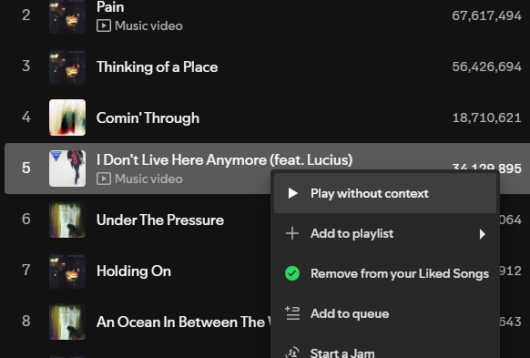

# Play without Context (Fixed)

A [Spicetify](https://spicetify.app/) extension that adds a **"Play without context"** item to the track context menu.

**This is a maintained, fixed fork of [Aimarekin's](https://github.com/Aimarekin/Aimarekins-Spicetify-Extensions) "Play without Context" extension.** The original stopped working on current Spotify builds and the upstream repository has not been updated since January 2025, so this fork carries the fix forward. A fix was also submitted upstream as [Aimarekin/Aimarekins-Spicetify-Extensions#23](https://github.com/Aimarekin/Aimarekins-Spicetify-Extensions/pull/23), but it has not been merged.



## What it does

When you play something from a source (like a playlist, album, or artist), Spotify gives you a playing context, so the next items played are sourced from that context.

You can play a single item without its context by, for example, searching for it and playing from search. This extension lets you do that in one step: right-click any item and select **"Play without context"**.

You can also select multiple items and choose the option. That plays the first item without context and prepends the rest to the queue.

## Why the original stopped working

Two independent failures, both completely silent:

1. **`Spicetify.URI` is no longer exposed** by recent Spicetify versions, so the URI type check threw a `TypeError` that was swallowed by a `tryCatch`, which made `shouldAdd()` return `false` for every URI and the item was never rendered. URI types are now parsed from the URI string itself (`spotify:track:x` -> `track`).
2. **The menu item was built before `Spicetify.ReactJSX` existed.** `ContextMenuV2.Item` renders itself with `Spicetify.ReactJSX.jsx()` inside its constructor, but `ReactJSX` is only assigned after the wrapper's asynchronous webpack initialisation. The item is now registered from `Spicetify.Events.webpackLoaded`, with a polled fallback that also waits for `Spicetify.ReactJSX`.

## Install

### Spicetify Marketplace

Install **"Play without Context (Fixed)"** from the Marketplace.

### Manually

Download [`_dist/play-without-context.js`](https://github.com/m1nuzz/spicetify-play-without-context/blob/main/_dist/play-without-context.js) (or the latest [release](https://github.com/m1nuzz/spicetify-play-without-context/releases)) and place it in your Spicetify `Extensions` folder, then:

```
spicetify config extensions play-without-context.js
spicetify apply
```

See [how to install extensions manually](https://spicetify.app/docs/advanced-usage/extensions) for details.

## Tested on

Spicetify **2.45.1** with Spotify **1.3.0.277** (Windows). Verified against a live client with the extension loaded through `spicetify apply` — not injected by hand, since a manual injection runs after full initialisation and hides one of the bugs above.

## Building

The extension is built with [ESBuild](https://esbuild.github.io/). Run `npm install` followed by `npm run build:dist` to compile the bundle into `_dist/play-without-context.js`.

## Credits & license

Original extension by [Aimarekin](https://github.com/Aimarekin). This fork keeps the same **[CC BY-NC 4.0](LICENSE)** license, with modifications — attribution, non-commercial use only, and no relicensing. Thanks to Aimarekin for the original work.
