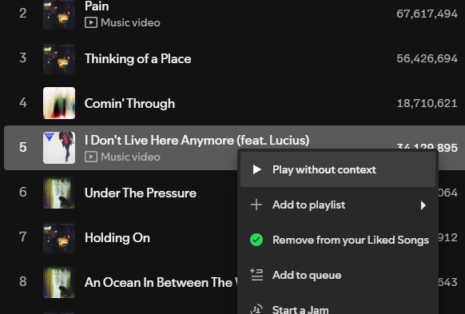

# Play without Context (Fixed)

A [Spicetify](https://spicetify.app/) extension that adds a **"Play without context"** item to the track context menu.

> **Maintained, fixed fork** of Aimarekin's ["Play without Context"](https://github.com/Aimarekin/Aimarekins-Spicetify-Extensions/tree/main/play-without-context) extension. The original stopped working on current Spotify builds and the upstream repository has not been updated since January 2025, so this fork carries the fix forward. A fix was also submitted upstream as [Aimarekin/Aimarekins-Spicetify-Extensions#23](https://github.com/Aimarekin/Aimarekins-Spicetify-Extensions/pull/23), but it has not been merged.

When you play something from a source (like a playlist, album, or artist), Spotify gives you a playing context, so next items played will be sourced from that context.

You can play only a single item without its context by, for example, searching it and playing from search. This extension allows you to quickly play something without a context by simply right clicking it and selecting **"Play without context"**.

You can also select multiple items and select the option. This will play the first item without context, and prepend the rest to the queue.

## What was fixed

Two independent failures, both silent (no error in the console):

1. **`Spicetify.URI` is no longer exposed** by recent Spicetify versions, so the URI type check threw a `TypeError` that was swallowed by `tryCatch`. `shouldAdd()` then returned `false` for every URI and the item was never rendered. URI types are now parsed from the URI string itself (`spotify:track:x` -> `track`).
2. **The menu item was built before `Spicetify.ReactJSX` existed.** `ContextMenuV2.Item` renders itself with `Spicetify.ReactJSX.jsx()` inside its constructor, but `ReactJSX` is only assigned after the wrapper's asynchronous webpack initialisation. The item is now registered from `Spicetify.Events.webpackLoaded`, with a polled fallback that also waits for `Spicetify.ReactJSX`.

Also: no hard dependency on `Spicetify.Locale` anymore (it is missing on some pages), `pullLocalizedString()` no longer throws on an unknown locale, and unexpected errors in `shouldAdd` are logged instead of silently hiding the menu item.

## Installation

With Spicetify Marketplace, install **"Play without Context (Fixed)"**.

Or manually, by placing the file [`_dist/play-without-context.js`](../_dist/play-without-context.js) in your Extensions folder, adding the extension to your config, and applying. [See how to install extensions manually](https://spicetify.app/docs/advanced-usage/extensions).

## Tested on

Spicetify **2.45.1** with Spotify **1.3.0.277** (Windows). Verified against a live client with the extension loaded through `spicetify apply` — not injected by hand, since a manual injection runs after full initialisation and hides the second bug above.

## Translating

This extension is localized. You can add a message saying "Play without context" in your language in the file [`src/localization/loc.json`](src/localization/loc.json)

## Building

This extension is built with [ESBuild](https://esbuild.github.io/). Run `npm install` followed by `npm run build:dist` to compile it into `_dist/play-without-context.js`.

---

## Credits & license

Original extension by [Aimarekin](https://github.com/Aimarekin). This fork keeps the same **[CC BY-NC 4.0](../LICENSE)** license, with modifications — attribution, non-commercial use only, and no relicensing. Thanks to Aimarekin for the original work.

[Source code available on GitHub](https://github.com/m1nuzz/spicetify-play-without-context/tree/main/play-without-context)

